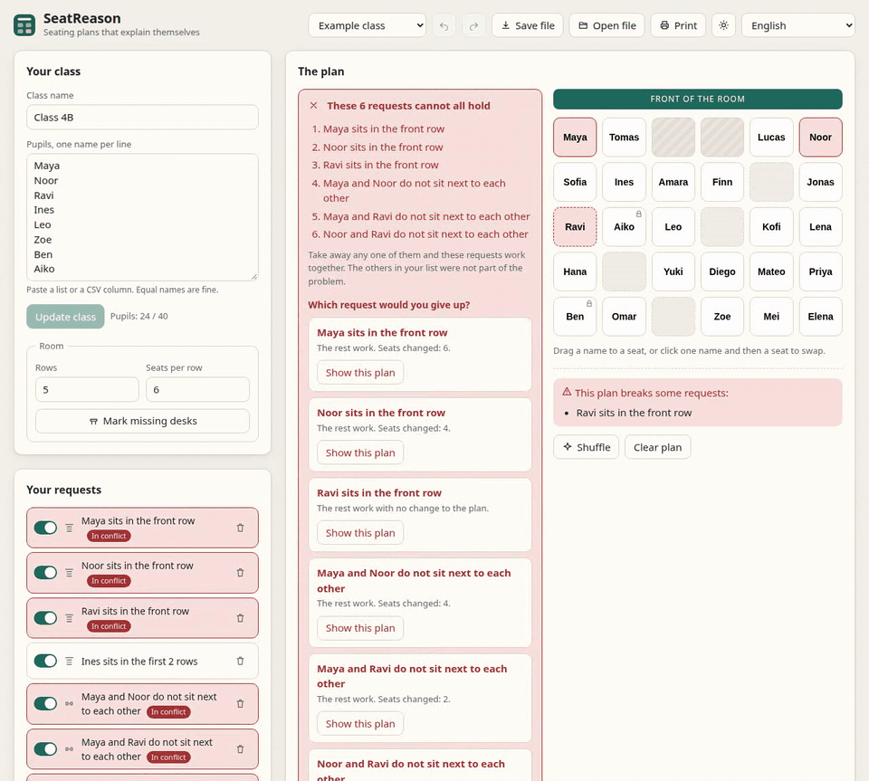

[Live-Demo](https://arthur031221.github.io/SeatReason/) | [English](README.md) | [繁體中文](README.zh-TW.md) | [简体中文](README.zh-CN.md) | [日本語](README.ja.md) | [한국어](README.ko.md) | [Español](README.es.md) | [Français](README.fr.md) | [Deutsch](README.de.md) | [Português (Brasil)](README.pt-BR.md)


# SeatReason

Sitzregeln, die erklären, warum sie nicht alle zugleich gelten können.

Median von 18 bis 32 ms, im schlechtesten Fall 0,38 s, um einen minimalen Konflikt zu finden, der den SAT-Löser braucht. Die Reparaturvorschauen für dieselben Fälle brauchen einen Median von 0,26 bis 0,49 s. 51 Fälle, fünf Läufe, Methode unter [Messungen](#messungen).

Die Wünsche einer Lehrkraft können zusammen unmöglich sein, und die meisten Planer antworten nur "keine Lösung". SeatReason nennt die wenigen Wünsche, die sich beißen, lässt Sie jeden einzeln aufgeben und prüft den ganzen Rest, bevor sich der Plan ändert.



Dies ist eine statische Web-App. Namen bleiben im Browser, nichts wird hochgeladen. Nach dem ersten Besuch öffnet sie sich auch ohne Netz, und der Browser kann sie als App installieren.

## Vorher und nachher

Das Beispiel "Enge erste Reihe": 24 Schüler, ein Raum mit 5 mal 6 Plätzen und zwei fehlenden Tischen, 10 Wünsche.

|                    | Vorher                                                | Nach der Wahl von "Noor sitzt in der ersten Reihe"        |
| ------------------ | ----------------------------------------------------- | --------------------------------------------------------- |
| Ergebnis           | "Diese 6 Wünsche lassen sich nicht zugleich erfüllen" | "Der Plan kann alle Wünsche erfüllen (9 eingeschaltet)"   |
| Was die Seite sagt | Die 6 Wünsche, nummeriert, in einfachen Worten        | Die Plätze, die wechseln, sind im Raum umrandet           |
| Geänderte Plätze   | Keine                                                 | 4                                                         |
| Plan ersetzt       | Nein                                                  | Erst nach "Diesen Plan nehmen und den Wunsch ausschalten" |

## So entsteht ein Plan

1. **Klasse beschreiben.** Fügen Sie Namen oder eine CSV-Spalte ein, bis zu 40 Schüler. Gleiche Namen werden über interne IDs getrennt. Stellen Sie Reihen und Plätze pro Reihe ein und markieren Sie fehlende Tische. Der Raum hat höchstens 48 Plätze.
2. **Wünsche hinzufügen.** Es gibt fünf Arten: einen festen Platz, einen Platz in den ersten N Reihen, einen Platz in den letzten N Reihen, zwei Schüler, die nicht nebeneinander sitzen sollen, und zwei, die nebeneinander sitzen sollen (links, rechts, davor oder dahinter). Jeder Wunsch lässt sich ausschalten, ohne ihn zu löschen.
3. **Ergebnis lesen.** Kurz nach jeder Änderung läuft die Prüfung von selbst in einem Worker, mit Abbrechen-Knopf. Sie endet als gelöst, unmöglich oder offen. Unmöglich kommt mit einer minimalen Menge von Wünschen: Schalten Sie einen beliebigen davon aus, und der Rest geht. SeatReason sagt das erst, nachdem jeder Wunsch der Menge getestet wurde.
4. **Eine Reparatur probieren.** Jeder Wunsch im Konflikt, nach dessen Entfernung der Rest gilt, hat einen Knopf "Diesen Plan ansehen". Die Vorschau plant ohne diesen Wunsch neu und behält die aktuellen Plätze, wo es geht. Geänderte Plätze sind umrandet. Der Plan wird nur ersetzt, wenn Sie den Knopf drücken, der das sagt.
5. **Anpassen und behalten.** Ziehen Sie Schüler oder klicken Sie zwei Plätze zum Tauschen an und legen Sie einen Schüler mit einem Knopf auf seinen aktuellen Platz fest. Eine Verschiebung, die einen Wunsch verletzt, wird mit Begründung angezeigt und lässt sich rückgängig machen. Die Klasse wird im Browser gespeichert, in eine `.seatreason.json`-Datei exportiert und als Plan mit Wunschübersicht gedruckt.

## Dateien

| Pfad                          | Zweck                                                                         |
| ----------------------------- | ----------------------------------------------------------------------------- |
| `src/core/sat.ts`             | Konfliktgesteuerter SAT-Löser mit Annahmen, Konfliktbudget und Stopp-Callback |
| `src/core/encode.ts`          | Übersetzt Sitzregeln in Klauseln, ein Selektor pro Wunsch                     |
| `src/core/hall.ts`            | Matching und Hall-Verletzer für feste Plätze und erste Reihen                 |
| `src/core/analyze.ts`         | Planung, Extraktion des minimalen Konflikts und Reparaturvorschauen           |
| `src/core/validate.ts`        | Unabhängige Planprüfung für App und Tests                                     |
| `src/core/oracle.ts`          | Vollständige Suche, nur in den Tests verwendet                                |
| `src/core/project.ts`         | Projektmodell, Verlaufsaktionen, Datei-Import und -Export                     |
| `src/worker.ts`, `src/hooks/` | Worker, Abbruch und Zeitlimit, Rückgängig-Verlauf                             |
| `src/ui/`, `src/style.css`    | Oberfläche, Sitzplan, Druckblatt, helles und dunkles Design                   |
| `src/locales/`                | Neun Sprachdateien und ein Test, dass sie dieselben Schlüssel haben           |
| `tests/e2e/`                  | Browsertests gegen die gebaute App                                            |
| `scripts/`                    | Benchmark, Demo-Aufnahme, Rendern der Social Card                             |
| `docs/`                       | Hinweise zu Installation, Nutzung, Konfiguration und Aufbau                   |

## Installation

```sh
git clone https://github.com/Arthur031221/SeatReason && cd SeatReason && npm ci && npm start
```

Die Seite ist danach unter `http://127.0.0.1:4173/` erreichbar.

<details>
<summary>Linux und macOS</summary>

Installieren Sie Node.js 22.12 oder neuer und führen Sie den Befehl oben im Terminal aus.

</details>

<details>
<summary>Windows</summary>

Installieren Sie Node.js 22.12 oder neuer. Führen Sie in PowerShell diese Befehle nacheinander aus:

```powershell
git clone https://github.com/Arthur031221/SeatReason
cd SeatReason
npm ci
npm start
```

</details>

<details>
<summary>Jeder statische Host</summary>

Führen Sie `npm ci && npm run build` aus und laden Sie den Ordner `dist/` hoch. Alle Pfade sind relativ, daher funktioniert es auch aus einem Unterordner. Es gibt keinen Servercode und nach dem Laden der Seite keine Netzwerkanfrage.

</details>

## Nutzung

Die Seite öffnet sich mit dem Beispiel "Enge erste Reihe", die Konfliktliste ist also schon da, mit einer Reparatur unter jedem Wunsch. Weitere Beispiele stehen unter Beispielklasse.

So nutzen Sie Ihre eigene Klasse:

1. Fügen Sie die Liste ein und drücken Sie "Klasse aktualisieren".
2. Stellen Sie die Raumgröße ein und markieren Sie fehlende Tische.
3. Fügen Sie Wünsche hinzu. Die Prüfung startet von selbst neu.
4. Drücken Sie unter einem Wunsch im Konflikt auf "Diesen Plan ansehen" und dann auf "Diesen Plan nehmen und den Wunsch ausschalten", wenn Sie ihn annehmen.
5. Drücken Sie "Drucken" für den Plan und die Wunschübersicht oder "Datei speichern" für eine Sicherung.

Einstellungen, Dateien und Grenzen stehen in [docs/config.md](docs/config.md). Details zu den Schritten stehen in [docs/usage.md](docs/usage.md).

## Messungen

`npm run bench` führt zwei Mengen zufälliger Klassen mit festen Startwerten aus, danach einen festen Fall. Die beiden Mengen stehen in der Tabelle.

- **Zufällige Klassen.** 40 Klassen mit je 40 Schülern in einem Raum mit 6 mal 8 Plätzen, jede mit 12 bis 31 zufälligen Wünschen der drei Arten. Jeder unmögliche Fall dieser Menge wird allein durch das Matching gefunden, weil zufällige feste Plätze und Vorderreihen schon lange miteinander kollidieren, bevor die zu trennenden Paare zählen.
- **Zu trennende Paare.** 80 Klassen, in denen 8 Schüler auf den 8 vorderen Plätzen sitzen müssen, mit 14 bis 26 zufälligen zu trennenden Paaren. Feste Plätze und Vorderreihen allein lassen sich immer erfüllen, also kommt jeder Konflikt dieser Menge vom SAT-Löser.

| Menge              | Ergebnis                            | Fälle | Median         | Langsamster      |
| ------------------ | ----------------------------------- | ----- | -------------- | ---------------- |
| Zufällige Klassen  | Gelöst                              | 19    | 8 bis 16 ms    | 17 bis 44 ms     |
| Zufällige Klassen  | Unmöglich, minimale Menge gefunden  | 21    | 8 bis 22 ms    | 20 bis 45 ms     |
| Zufällige Klassen  | Reparaturvorschauen für diese Fälle | 21    | 20 bis 43 ms   | 26 bis 71 ms     |
| Zu trennende Paare | Gelöst                              | 29    | 3 bis 5 ms     | 10 bis 22 ms     |
| Zu trennende Paare | Unmöglich, minimale Menge gefunden  | 51    | 18 bis 32 ms   | 327 bis 382 ms   |
| Zu trennende Paare | Reparaturvorschauen für diese Fälle | 51    | 262 bis 492 ms | 1234 bis 2133 ms |

Jede Zelle ist die Spanne aus fünf Läufen von `npm run bench`, auf einem AMD Ryzen 5 7500F mit Node 24.21, ein Thread, auf der Kommandozeile ohne Browser. Auf der Maschine liefen nebenher andere Aufgaben, deshalb unterscheiden sich die Läufe. Die Fälle sind jedes Mal dieselben. Es sind zufällige Klassen. Eine echte Klasse mit vielen Paaren, die getrennt werden sollen, kann schwerer sein. Die Messung erlaubt dem Planen 20 Sekunden und begrenzt die Vorschauen nicht, während die Seite sich 8 Sekunden teilt. Der langsamste Fall dauerte hier 2,1 Sekunden.

Die Messung endet mit einem festen Fall: neun Schüler wollen alle die acht vorderen Plätze. Das Matching entscheidet ihn in 2 bis 5 ms.

Die Tests vergleichen den Löser in kleinen Räumen mit einer vollständigen Suche. Sie prüfen auch, dass jeder gemeldete Konflikt minimal ist und dass jeder reparierte Plan die unabhängige Prüfung besteht.

## Grenzen

- Viele gegenseitig zu trennende Paare in einem engen Raum können für das Limit von 8 Sekunden zu schwer sein. Die Seite meldet dann "offen" und behauptet nicht, die Regeln seien unmöglich. Neun Schüler, die alle voneinander getrennt sitzen müssen, in einem Raum mit 4 mal 4 Plätzen sind so ein Fall.
- Getrennt heißt, keine Nachbarn nach oben, unten, links oder rechts. Diagonale Plätze sind erlaubt. Nebeneinandersetzen verlangt dieselbe Art Nachbar, ein diagonaler Platz zählt nicht.
- Die Reparaturvorschau probiert einen Wunsch nach dem anderen. Sie sucht nicht die Reparatur mit den wenigsten geänderten Plätzen.
- Es gibt nur fünf Arten von Wünschen. Es gibt keinen Geschlechterausgleich, keine Gruppentische und keine Rotation.

## Gestaltungsprinzipien

- Eine gescheiterte Prüfung wird als gescheitert gemeldet. Zeitablauf wird nie als unmöglich gemeldet.
- Ein Plan wird von Code geprüft, der die Kodierung des Lösers nicht teilt. In den Tests wird jeder Konflikt mit einer vollständigen Suche verglichen.
- Ein von der Lehrkraft von Hand angeordneter Plan wird nur auf deren Wahl ersetzt. Nach einer Änderung an Klasse oder Wünschen wird ein Plan, der einen Wunsch verletzt, neu geplant, und Rückgängig stellt ihn wieder her.
- Namen bleiben auf dem Gerät. Die Beispielklassen sind erfunden.

## Entwicklung

`npm run typecheck`, `npm run lint`, `npm run format:check`, `npm test`, `npm run build` und `npm run test:e2e` sind die Prüfungen, die CI ausführt. Siehe [CONTRIBUTING.md](CONTRIBUTING.md) und [docs/architecture.md](docs/architecture.md).

MIT-Lizenz.

Assisted by Claude/Codex.
